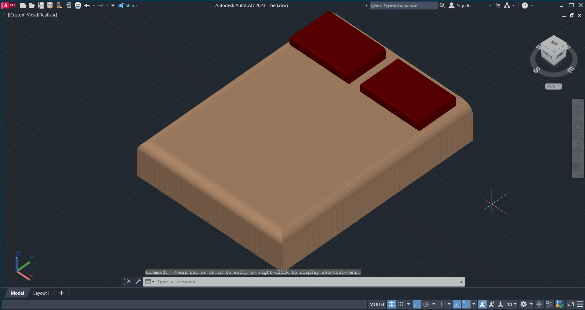
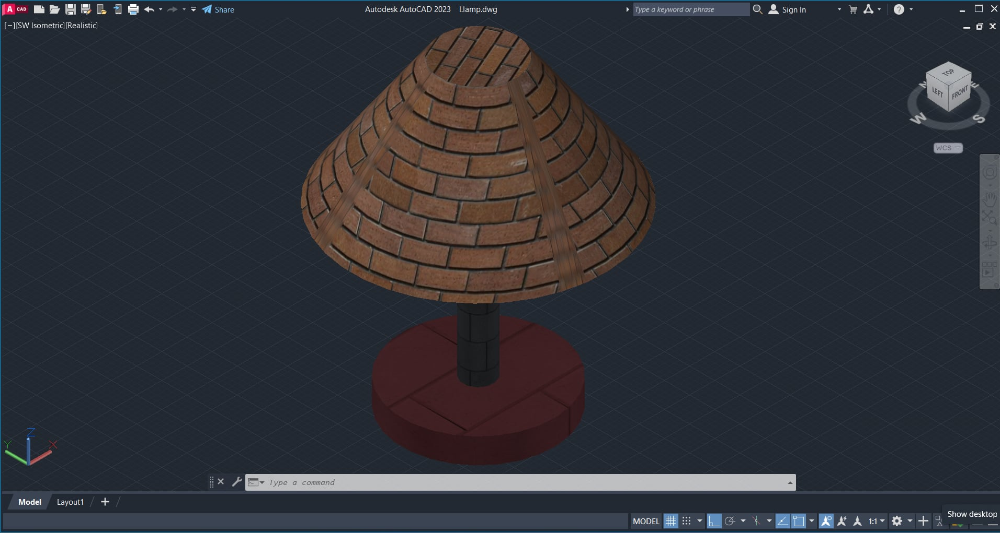
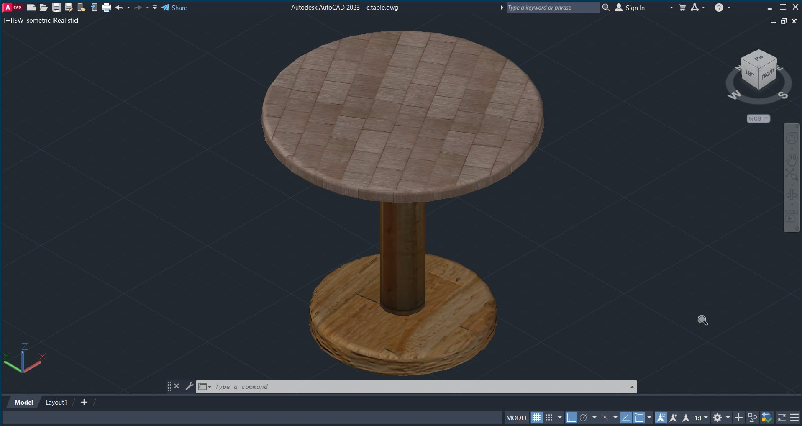

# Appliances

AutoCAD 2D furniture and appliance blocks for use in floor plans and interior layouts.

## Contents

| Item | Folder | DWG File | Preview |
| --- | --- | --- | --- |
| Bed | `Bed` | `bed.dwg` | `46ef5083-f344-4a4f-bd86-961d151e9737.jpg` |
| Desk of Books | `Desk of Books` | `tablewithbook.dwg` | `4b3978d9-ecaa-4529-aa15-321a332e07cb.jpg` |
| Lamp | `Lamp` | `l.lamp.dwg` | `8fa83a00-3c84-4329-8bf9-bdace9c87e46.jpg` |
| Storage Desk | `Storage desk` | `aparador.dwg` | `039c3c3d-739c-449e-9761-22f5977b8186.jpg` |
| Table | `table` | `c.table.dwg` | `4e0dacdb-27be-4bb2-be67-7e018a37aa94.jpg` |

## Previews

### Bed



### Desk of Books


### Lamp



### Storage Desk


### Table



## Repository Structure

```
appliances/
├── Bed/
│   ├── bed.dwg
│   └── 46ef5083-f344-4a4f-bd86-961d151e9737.jpg
├── Desk of Books/
│   ├── tablewithbook.dwg
│   └── 4b3978d9-ecaa-4529-aa15-321a332e07cb.jpg
├── Lamp/
│   ├── l.lamp.dwg
│   └── 8fa83a00-3c84-4329-8bf9-bdace9c87e46.jpg
├── Storage desk/
│   ├── aparador.dwg
│   └── 039c3c3d-739c-449e-9761-22f5977b8186.jpg
├── table/
│   ├── c.table.dwg
│   └── 039c3c3d-739c-449e-9761-22f5977b8186.jpg
└── README.md
```

## How to Use

1. Download or clone the repository.
2. Open the `.dwg` file of the item you need in AutoCAD.
3. Copy the object with Ctrl+C and paste it into your floor plan with Ctrl+V, or use the `INSERT` command and browse to the `.dwg` file.
4. Use the `.jpg` image to preview each item without opening CAD software.

## Requirements

- AutoCAD 2018 or later, or DWG TrueView (free from Autodesk)

## Clone

```
git clone https://github.com/LouiseCatala/Appliances.git
```

## Author

Orland Louise Catala
GitHub: [@LouiseCatala](https://github.com/LouiseCatala)
